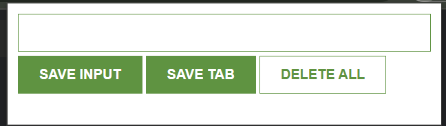

# Chrome-Extension
# Leads Tracker

A lightweight Chrome extension for saving links and keeping them one click away. Save the page you're on or paste any URL, and your list stays in the popup even after you close the browser.


---

## Features

- **Save Input**: type or paste a link into the text box and save it to your list
- **Save Tab**: save the URL of the page you're currently viewing with one click
- **Clickable list**: every saved link opens in a new tab
- **Persistent storage**: leads are kept in `localStorage`, so they survive closing the popup or browser
- **Delete All**: clear the whole list by double-clicking the button (the double-click prevents accidental deletes)

## Screenshots

<!-- Add screenshots to a /screenshots folder and link them here -->


---

## Installation (Developer Mode)

1. Download or clone this repository:
   ```bash
   git clone https://github.com/Swetanki/Chrome-Extension.git
   ```
2. Open Chrome and go to `chrome://extensions`.
3. Turn on **Developer mode** (top-right toggle).
4. Click **Load unpacked** and select the project folder (the one containing `manifest.json`).
5. Click the puzzle-piece icon in the toolbar and pin **Leads Tracker**.

After editing the code, click the reload icon on the extension's card in `chrome://extensions`.

---

## Usage

| Action | How |
|---|---|
| Save a typed link | Enter the URL in the text box and click **SAVE INPUT** |
| Save the current page | Click **SAVE TAB** |
| Open a saved link | Click it in the list (opens in a new tab) |
| Clear everything | **Double-click** **DELETE ALL** |

---

## Project Structure

```
leads-tracker/
├── manifest.json    # Extension config (Manifest V3, popup, permissions, icon)
├── index.html       # Popup UI
├── script.js        # Popup logic: save, render, delete, localStorage
├── style.css        # Popup styling
└── dollar icon.jpg  # Toolbar icon
```

## How It Works

1. On load, `script.js` reads `myLeads` from `localStorage` and renders it.
2. **SAVE INPUT** pushes the text box value into the `myLeads` array.
3. **SAVE TAB** calls `chrome.tabs.query({ active: true, currentWindow: true })` and pushes the active tab's URL into the array.
4. After every change, the array is saved with `localStorage.setItem` as JSON and `render()` rebuilds the `<ul>` list.
5. **DELETE ALL** (on `dblclick`) clears storage, empties the array, and re-renders.

---

## Permissions

| Permission | Why it's needed |
|---|---|
| `tabs` | Read the URL of the active tab for the **SAVE TAB** button |

All data stays in your browser's local storage. Nothing is sent to any server.

---

## Tech Stack

- HTML, CSS, vanilla JavaScript
- Chrome Extensions API (Manifest V3): `chrome.tabs`
- Web Storage API (`localStorage`)

---

## Roadmap

- [ ] Delete individual leads
- [ ] Prevent duplicate entries
- [ ] Use `chrome.storage` so leads sync across devices
- [ ] Export leads to CSV
- [ ] Publish to the Chrome Web Store


